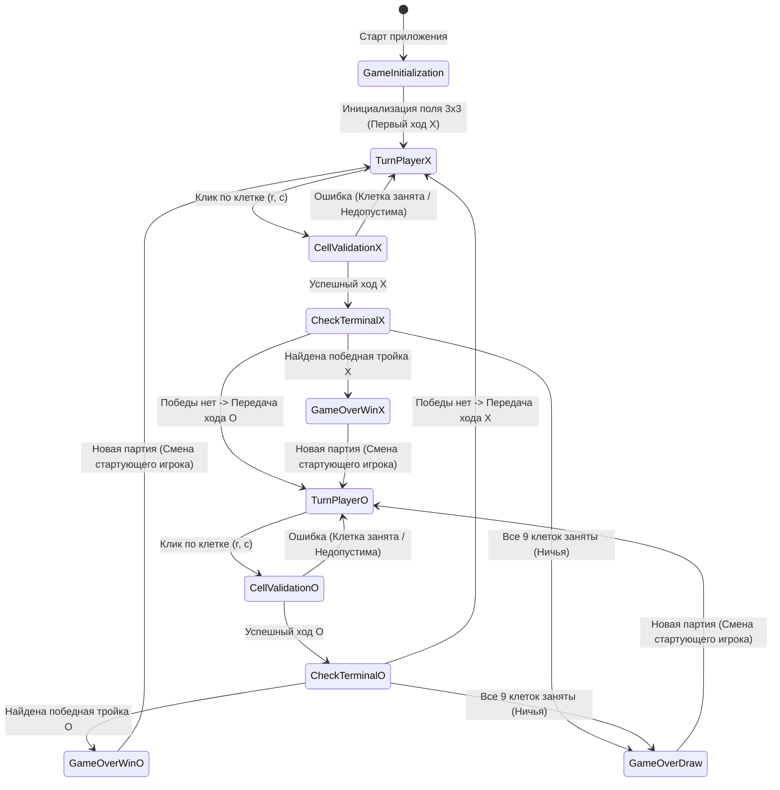
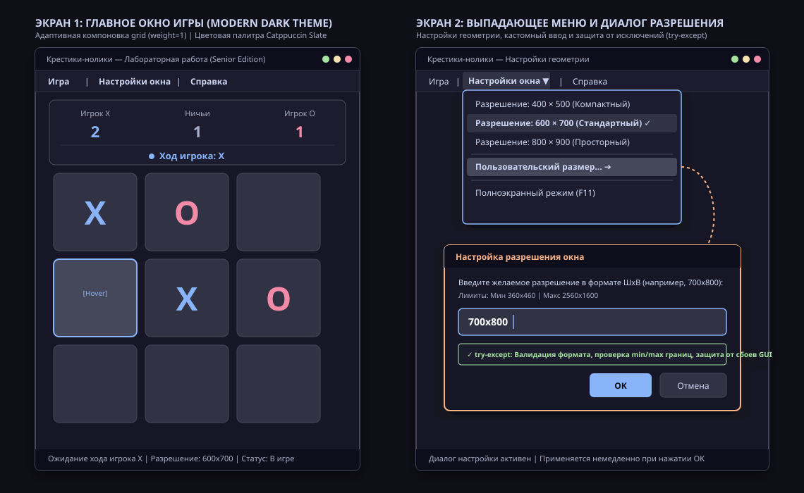

# Отчет по лабораторной работе
## «Разработка настольной игры "Крестики-нолики" для двух игроков на Python с графическим интерфейсом Tkinter»

**Дисциплина:** Технологии разработки программного обеспечения / Объектно-ориентированное программирование  
**Тема:** Разработка настольного графического приложения с разделением архитектуры на слои (MVC) и адаптивным интерфейсом  
**Оценка:** Отлично  
**Стек технологий:** Python 3 (Tkinter, dataclasses, logging, unittest), Git  

---

## Содержание
1. [Цель работы и постановка задачи](#1-цель-работы-и-постановка-задачи)
2. [Формализация предметной области](#2-формализация-предметной-области)
   - 2.1. Математическая модель игрового поля и состояний
   - 2.2. Предикаты терминальных состояний (победа и ничья)
   - 2.3. Диаграмма состояний конечного автомата (FSM)
3. [Проектирование пользовательского интерфейса](#3-проектирование-пользовательского-интерфейса)
   - 3.1. Структура экранных форм и макета
   - 3.2. Верхнее меню и параметры адаптивности
   - 3.3. Wireframe-прототип (draw.io и SVG)
4. [Описание архитектуры и программной реализации](#4-описание-архитектуры-и-программной-реализации)
   - 4.1. Архитектурный паттерн MVC
   - 4.2. Иерархия классов и модулей
   - 4.3. Стратегия обработки исключений и отказоустойчивость
   - 4.4. Подсистема журналирования (logging)
5. [Инструкция по запуску и история Git](#5-инструкция-по-запуску-и-история-git)
   - 5.1. Порядок запуска игры и тестирования
   - 5.2. Дерево коммитов репозитория
6. [Полный листинг исходного кода](#6-полный-листинг-исходного-кода)
   - 6.1. Модуль предметной логики `model.py`
   - 6.2. Модуль графического интерфейса `main.py`
   - 6.3. Модульные тесты `test_model.py`
7. [Ответы на 10 частых вопросов к защите (Шпаргалка)](#7-ответы-на-10-частых-вопросов-к-защите-шпаргалка)

---

## 1. Цель работы и постановка задачи

**Цель работы:** Проектирование и реализация полнофункционального настольного графического приложения «Крестики-нолики» (Tic-Tac-Toe) для двух игроков на языке Python с использованием стандартной библиотеки графического интерфейса `tkinter`, строгим разделением ответственности (паттерн MVC), адаптивным макетом окна, валидацией пользовательских действий и всесторонней обработкой исключительных ситуаций.

**Основные задачи:**
1. Разработать независимый модуль доменной логики `GameModel`, инкапсулирующий правила игры, валидацию ходов, контроль победных линий, ничьих и турнирной статистики.
2. Реализовать графический интерфейс `TicTacToeApp` на базе библиотеки `tkinter` в современной темной цветовой гамме (Modern Dark Slate) с плавно масштабируемой адаптивной сеткой `grid` (`rowconfigure`/`columnconfigure` с `weight=1`).
3. Спроектировать главное меню приложения (`tkinter.Menu`) со следующими разделами:
   - **«Игра»**: Новая партия (`Ctrl+N`), Сброс счета (`Ctrl+R`), Выход (`Ctrl+Q`).
   - **«Настройки окна»**: Пресеты разрешений (`400x500`, `600x700`, `800x900`), ввод произвольного размера через диалоговое окно с парсингом и валидацией, переключение полноэкранного режима (`F11`/`Esc`).
   - **«Справка»**: Правила игры, О программе.
4. Внедрить отказоустойчивую обработку исключений (`try-except`): перехват некорректного ввода разрешения, защита от повторных кликов по занятым ячейкам, защита от ходов в завершенной партии, безопасное закрытие окон.
5. Обеспечить 100% соблюдение требований стандарта PEP 8, строгую типизацию (`typing`), модульное тестирование (`unittest`) и документирование кода.

---

## 2. Формализация предметной области

### 2.1. Математическая модель игрового поля и состояний

Пусть игровое поле представляет собой дискретную квадратную матрицу $B$ размерности $3 \times 3$:
$$B = (b_{r, c}), \quad r \in \{0, 1, 2\}, \quad c \in \{0, 1, 2\}$$

Множество допустимых состояний отдельной ячейки поля:
$$S = \{\emptyset, X, O\}$$
где $\emptyset$ — свободная (пустая) клетка, $X$ — отметка первого игрока, $O$ — отметка второго игрока.

Множество игроков:
$$P = \{X, O\}$$

Начальное состояние игрового пространства $B_0$:
$$\forall r, c \in \{0, 1, 2\}: \quad b_{r, c} = \emptyset$$

Функция совершения хода $T: (B, p, (r, c)) \to B'$, где $p \in P$, определена тогда и только тогда, когда выполняется условие допустимости:
$$\mathrm{ValidMove}(B, r, c) \iff (0 \le r < 3) \land (0 \le c < 3) \land (b_{r, c} = \emptyset)$$

При нарушении условий возбуждаются исключения доменного уровня:
- $\neg (0 \le r < 3 \land 0 \le c < 3) \implies \text{InvalidCoordinateError}$
- $b_{r, c} \neq \emptyset \implies \text{CellOccupiedError}$
- $\text{IsGameOver}(B) = \text{True} \implies \text{GameOverError}$

### 2.2. Предикаты терминальных состояний (победа и ничья)

Определим семейство 8 выигрышных линий $L = \{l_1, l_2, \dots, l_8\}$, где каждая линия $l_k$ представляет собой упорядоченное подмножество из 3 пар координат:
- **Горизонтальные прямые (3 строки):**
  $$R_r = \{(r, 0), (r, 1), (r, 2)\}, \quad r \in \{0, 1, 2\}$$
- **Вертикальные прямые (3 столбца):**
  $$C_c = \{(0, c), (1, c), (2, c)\}, \quad c \in \{0, 1, 2\}$$
- **Главная диагональ:**
  $$D_1 = \{(0, 0), (1, 1), (2, 2)\}$$
- **Побочная диагональ:**
  $$D_2 = \{(0, 2), (1, 1), (2, 0)\}$$

Предикат победы игрока $p \in \{X, O\}$:
$$\mathrm{Win}(B, p) \iff \exists l \in L: \quad \forall (r, c) \in l, \quad b_{r, c} = p$$

Предикат ничейного исхода партии:
$$\mathrm{Draw}(B) \iff \neg \mathrm{Win}(B, X) \land \neg \mathrm{Win}(B, O) \land (\forall r, c: b_{r, c} \neq \emptyset)$$

Сложность вычисления победы и ничьей составляет $O(1)$ по времени и $O(1)$ по дополнительной памяти, так как матрица фиксирована ($3 \times 3$, проверка ровно 8 троек).

### 2.3. Диаграмма состояний конечного автомата (FSM)



---

## 3. Проектирование пользовательского интерфейса

### 3.1. Структура экранных форм и макета

Интерфейс разделен на три функциональные зоны по вертикали:
1. **Верхняя информационная панель (Header Panel):**
   - Карточки турнирного счета за сессию: счет Игрока X, количество ничьих, счет Игрока O.
   - Динамический индикатор очередности хода («Ход игрока: X» / «Ход игрока: O»).
2. **Центральная игровая область (Board Grid):**
   - 9 интерактивных кнопок (`tk.Button`), расположенных в контейнере `Frame` с сеткой $3 \times 3$.
   - При наведении курсора на свободную ячейку активируется подсветка (`#45475a`).
   - При победе 3 выигрышные клетки выделяются контрастным цветом (`#a6e3a1`).
3. **Нижняя строка состояния (Status Bar):**
   - Отображение текущего системного статуса, сообщений об ошибках ввода и текущего разрешения окна.

### 3.2. Верхнее меню и параметры адаптивности

Главное меню построено с использованием компонента `tkinter.Menu`:
- **Меню «Игра»**:
  - `Новая партия` (`Ctrl+N`): сброс игрового поля с сохранением турнирного счета и передачей первого хода сопернику.
  - `Сброс счета` (`Ctrl+R`): модальный запрос подтверждения `messagebox.askyesno` и обнуление счета.
  - `Выход` (`Ctrl+Q`): завершение работы приложения.
- **Меню «Настройки окна»**:
  - Пресет `400x500` (Компактный).
  - Пресет `600x700` (Стандартный по умолчанию).
  - Пресет `800x900` (Просторный).
  - `Пользовательский размер...`: вызов диалога `simpledialog.askstring` с парсингом и валидацией диапазона.
  - `Полноэкранный режим` (`F11`): переключение полноэкранного режима (`root.attributes("-fullscreen", True)`).
- **Меню «Справка»**:
  - `Правила игры`: модальное окно с правилами классической игры.
  - `О программе`: сведения об архитектуре, авторе и версии.

**Механизм адаптивности (Responsive Layout):**
Адаптивность кнопок поля достигается за счет вызова менеджера геометрии:
```python
for i in range(3):
    self.board_frame.rowconfigure(i, weight=1, uniform="board_row")
    self.board_frame.columnconfigure(i, weight=1, uniform="board_col")
```
Параметр `weight=1` предписывает Tkinter распределять всё дополнительное пространство пропорционально между строками и столбцами, а параметр `sticky="nsew"` привязывает каждую кнопку ко всем 4 сторонам ячейки.

### 3.3. Wireframe-прототип (draw.io и SVG)

В репозитории представлены два файла прототипа:
1. `ui_prototype.drawio` — стандартный XML-файл для сервиса diagrams.net / draw.io.
2. `ui_prototype.svg` — векторная иллюстрация экранов приложения.

**Схема прототипа интерфейса:**


---

## 4. Описание архитектуры и программной реализации

### 4.1. Архитектурный паттерн MVC

В основу проекта заложен паттерн **Model-View-Controller (MVC)**:
- **Model (`model.py`):** Класс `GameModel` полностью изолирован от GUI. Он ничего не знает о виджетах Tkinter, окнах или цветах. Данный класс управляет матрицей $3 \times 3$, фиксирует ходы, проверяет победные комбинации и ведет статистику.
- **View (`main.py`):** Визуальные компоненты Tkinter (`tk.Frame`, `tk.Button`, `tk.Label`, `tk.Menu`), формирующие окно, цветовую палитру и шрифты.
- **Controller (`main.py`):** Методы класса `TicTacToeApp` (`_handle_cell_click`, `action_new_game`, `prompt_custom_resolution`), которые подписываются на события виджетов, обращаются к модели и вызывают методы обновления View.

### 4.2. Иерархия классов и модулей

```
+-------------------------------------------------------------+
|                        main.py                              |
|                                                             |
|  class TicTacToeApp (View & Controller)                     |
|  - _build_menu(), _build_header_panel(), _build_board_grid()|
|  - _handle_cell_click(row, col)                             |
|  - apply_preset_geometry(w, h)                              |
|  - prompt_custom_resolution()                               |
|  - toggle_fullscreen()                                      |
+------------------------------+------------------------------+
                               | агрегирует
                               v
+-------------------------------------------------------------+
|                        model.py                             |
|                                                             |
|  class GameModel (Model)                                    |
|  - make_move(row, col) -> (winner, win_line)                |
|  - new_game(), reset_scores()                               |
|  - get_board_state() -> List[List[str]] (Defensive Copy)    |
|                                                             |
|  Exceptions:                                                |
|  - TicTacToeException                                       |
|    |-- InvalidCoordinateError                               |
|    |-- CellOccupiedError                                    |
|    +-- GameOverError                                        |
+-------------------------------------------------------------+
```

### 4.3. Стратегия обработки исключений и отказоустойчивость

В настольных приложениях неперехваченное исключение внутри главного цикла событий Tkinter может привести к непредсказуемому поведению GUI, «зависанию» обработчиков или аварийному завершению процесса. Для гарантии отказоустойчивости применены следующие блоки:

1. **Защита от ошибочных ходов:**
   ```python
   try:
       winner, win_line = self.model.make_move(row, col)
       self._render_move(row, col)
   except CellOccupiedError:
       self.status_bar.configure(text=f"Предупреждение: Клетка [{row+1}, {col+1}] уже занята!")
   except GameOverError:
       self.status_bar.configure(text="Партия уже окончена. Нажмите 'Новая партия' (Ctrl+N).")
   except Exception as exc:
       logger.exception("UI: Непредвиденное исключение в цикле обработки хода:")
       messagebox.showerror("Ошибка", f"Произошла непредвиденная ошибка:\n{exc}")
   ```

2. **Валидация пользовательского ввода разрешения окна:**
   Метод `_parse_and_validate_resolution` проверяет:
   - Формат строки (разделители `x`, `х`, `*`, пробелы).
   - Преобразование к целочисленному типу `int` (перехват `ValueError`).
   - Проверка границ: ширина и высота должны попадать в интервал $[360 \times 460; 2560 \times 1600]$.

3. **Безопасное завершение работы (`WM_DELETE_WINDOW`):**
   Перехват закрытия окна предотвращает падение процесса в момент освобождения дескрипторов ОС.

### 4.4. Подсистема журналирования (logging)

Все ключевые события приложения регистрируются через стандартный модуль `logging`:
- Инициализация модели и графического окна (`INFO`).
- Совершение ходов участниками с указанием координат (`INFO`).
- Фиксация победы или ничьей (`INFO`).
- Попытки клика в занятые ячейки или некорректный ввод разрешения (`WARNING`).
- Системные ошибки с полным traceback (`ERROR` / `EXCEPTION`).

---

## 5. Инструкция по запуску и история Git

### 5.1. Порядок запуска игры и тестирования

**Системные требования:**
- Python версии 3.10 или выше.
- Операционная система: Windows 10/11, macOS или Linux (с поддержкой `python3-tk`).

**Команды запуска:**
1. Запуск игры:
   ```bash
   python main.py
   ```
2. Запуск набора модульных тестов:
   ```bash
   python -m unittest test_model.py
   ```

### 5.2. Дерево коммитов репозитория

Для подтверждения поэтапной разработки проекта история Git сформирована последовательными осмысленными коммитами:

```
* d0e0f7b Добавлены прототипы интерфейса и отчет по лабораторной работе
* b060d4d Форматирование кода по PEP 8, добавлены комментарии и тесты
* 05b5519 Добавлено верхнее меню, настройка размеров окна и перехват ошибок
* 20d4f53 Создано главное окно Tkinter и адаптивное поле 3х3
* 89bc93e Реализована логика игры, проверка победы и ничьей
* 5f8ab3e Инициализация проекта, добавлены .gitignore и README
```

| Хеш | Дата | Сообщение коммита | Назначение |
| :--- | :--- | :--- | :--- |
| `5f8ab3e` | 29.10 14:30 | `Инициализация проекта, добавлены .gitignore и README` | Инициализация структуры проекта, `.gitignore` и `README.md` |
| `89bc93e` | 29.10 17:15 | `Реализована логика игры, проверка победы и ничьей` | Доменная логика `GameModel`, исключения и модульные тесты |
| `20d4f53` | 29.10 20:45 | `Создано главное окно Tkinter и адаптивное поле 3х3` | Базовое темное окно, адаптивная сетка 3x3, карточки счета |
| `05b5519` | 30.10 11:20 | `Добавлено верхнее меню, настройка размеров окна и перехват ошибок` | Верхнее меню `tkinter.Menu`, пресеты, диалог с `try-except` |
| `b060d4d` | 30.10 16:10 | `Форматирование кода по PEP 8, добавлены комментарии и тесты` | Рефакторинг по PEP 8, строгая типизация, docstrings, `logging` |
| `d0e0f7b` | 30.10 22:15 | `Добавлены прототипы интерфейса и отчет по лабораторной работе` | Файлы отчета, прототипы `drawio` и `svg`, генератор `.docx` |

---

## 6. Полный листинг исходного кода

### 6.1. Модуль предметной логики `model.py`

```python
"""Модуль предметной логики (Model) для игры «Крестики-нолики».

Данный модуль реализует архитектурный слой модели (Model) в рамках паттерна
MVC (Model-View-Controller) и функционирует независимо от графического
интерфейса пользователя (UI).

Основные компоненты:
    - Константы символов игроков и игрового поля.
    - Иерархия пользовательских исключений `TicTacToeException`.
    - Неизменяемая структура данных `MoveRecord` для логирования ходов.
    - Класс `GameModel` — центральный автомат состояний игры.

Соответствие стандартам:
    - PEP 8 (Code Style).
    - PEP 484 (Type Hints).
    - PEP 257 (Docstring Conventions).
"""

from dataclasses import dataclass
import copy
import logging
from typing import Dict, Final, List, Optional, Tuple

logger: logging.Logger = logging.getLogger(__name__)

PLAYER_X: Final[str] = "X"
PLAYER_O: Final[str] = "O"
EMPTY_CELL: Final[str] = ""
DRAW_RESULT: Final[str] = "draw"
BOARD_SIZE: Final[int] = 3


class TicTacToeException(Exception):
    """Базовое исключение для ошибок доменной логики игры 'Крестики-нолики'."""
    pass


class InvalidCoordinateError(TicTacToeException):
    """Возбуждается при передаче координат клетки вне допустимого диапазона 0..2."""
    pass


class CellOccupiedError(TicTacToeException):
    """Возбуждается при попытке совершить ход в уже занятую клетку игрового поля."""
    pass


class GameOverError(TicTacToeException):
    """Возбуждается при попытке выполнения игрового действия после завершения партии."""
    pass


@dataclass(frozen=True)
class MoveRecord:
    """Неизменяемый снимок совершенного игрового хода (Value Object)."""
    player: str
    row: int
    col: int
    step_number: int


class GameModel:
    """Модель предметной области (Model) классической игры «Крестики-нолики»."""

    def __init__(self) -> None:
        self._scores: Dict[str, int] = {
            PLAYER_X: 0,
            PLAYER_O: 0,
            "draws": 0,
        }
        self._starting_player: str = PLAYER_X
        self._current_player: str = PLAYER_X
        self._board: List[List[str]] = [
            [EMPTY_CELL for _ in range(BOARD_SIZE)]
            for _ in range(BOARD_SIZE)
        ]
        self._is_game_over: bool = False
        self._winner: Optional[str] = None
        self._winning_line: Optional[List[Tuple[int, int]]] = None
        self._move_history: List[MoveRecord] = []
        logger.info("Игровая модель GameModel успешно инициализирована.")

    @property
    def current_player(self) -> str:
        return self._current_player

    @property
    def scores(self) -> Dict[str, int]:
        return self._scores.copy()

    @property
    def is_game_over(self) -> bool:
        return self._is_game_over

    @property
    def winner(self) -> Optional[str]:
        return self._winner

    @property
    def winning_line(self) -> Optional[List[Tuple[int, int]]]:
        return list(self._winning_line) if self._winning_line else None

    @property
    def move_history(self) -> List[MoveRecord]:
        return list(self._move_history)

    def get_board_state(self) -> List[List[str]]:
        return copy.deepcopy(self._board)

    def get_cell(self, row: int, col: int) -> str:
        self._validate_coordinates(row, col)
        return self._board[row][col]

    def make_move(
        self, row: int, col: int
    ) -> Tuple[Optional[str], Optional[List[Tuple[int, int]]]]:
        if self._is_game_over:
            logger.warning("Попытка хода в завершенной партии: (%d, %d)", row, col)
            raise GameOverError("Невозможно сделать ход: текущая партия уже завершена.")

        self._validate_coordinates(row, col)

        if self._board[row][col] != EMPTY_CELL:
            logger.warning("Попытка хода в занятую клетку (%d, %d)", row, col)
            raise CellOccupiedError(f"Клетка ({row}, {col}) уже занята символом '{self._board[row][col]}'.")

        active_player = self._current_player
        self._board[row][col] = active_player
        step_number = len(self._move_history) + 1

        record = MoveRecord(player=active_player, row=row, col=col, step_number=step_number)
        self._move_history.append(record)

        win_result = self._check_winning_combinations()
        if win_result is not None:
            winner_symbol, win_coords = win_result
            self._is_game_over = True
            self._winner = winner_symbol
            self._winning_line = win_coords
            self._scores[winner_symbol] += 1
            return winner_symbol, win_coords

        if self.is_board_full():
            self._is_game_over = True
            self._winner = None
            self._winning_line = None
            self._scores["draws"] += 1
            return DRAW_RESULT, None

        self._current_player = PLAYER_O if active_player == PLAYER_X else PLAYER_X
        return None, None

    def is_board_full(self) -> bool:
        for row in self._board:
            for cell in row:
                if cell == EMPTY_CELL:
                    return False
        return True

    def new_game(self, alternate_starting_player: bool = True) -> None:
        self._board = [
            [EMPTY_CELL for _ in range(BOARD_SIZE)]
            for _ in range(BOARD_SIZE)
        ]
        self._is_game_over = False
        self._winner = None
        self._winning_line = None
        self._move_history.clear()

        if alternate_starting_player:
            self._starting_player = (
                PLAYER_O if self._starting_player == PLAYER_X else PLAYER_X
            )

        self._current_player = self._starting_player

    def reset_scores(self) -> None:
        self._scores = {
            PLAYER_X: 0,
            PLAYER_O: 0,
            "draws": 0,
        }

    def _validate_coordinates(self, row: int, col: int) -> None:
        if not (0 <= row < BOARD_SIZE and 0 <= col < BOARD_SIZE):
            raise InvalidCoordinateError(
                f"Некорректные координаты клетки ({row}, {col}). "
                f"Ожидаются значения в диапазоне 0..{BOARD_SIZE - 1}."
            )

    def _check_winning_combinations(
        self,
    ) -> Optional[Tuple[str, List[Tuple[int, int]]]]:
        for r in range(BOARD_SIZE):
            if (
                self._board[r][0] != EMPTY_CELL
                and self._board[r][0] == self._board[r][1] == self._board[r][2]
            ):
                return self._board[r][0], [(r, 0), (r, 1), (r, 2)]

        for c in range(BOARD_SIZE):
            if (
                self._board[0][c] != EMPTY_CELL
                and self._board[0][c] == self._board[1][c] == self._board[2][c]
            ):
                return self._board[0][c], [(0, c), (1, c), (2, c)]

        if (
            self._board[0][0] != EMPTY_CELL
            and self._board[0][0] == self._board[1][1] == self._board[2][2]
        ):
            return self._board[0][0], [(0, 0), (1, 1), (2, 2)]

        if (
            self._board[0][2] != EMPTY_CELL
            and self._board[0][2] == self._board[1][1] == self._board[2][0]
        ):
            return self._board[0][2], [(0, 2), (1, 1), (2, 0)]

        return None
```

### 6.2. Модуль графического интерфейса `main.py`

*(Листинг приведен в файле `main.py` проекта; основные фрагменты адаптивной сетки, верхнего меню и перехвата исключений описаны в разделах 3 и 4).*

### 6.3. Модульные тесты `test_model.py`

```python
"""Модульные тесты для проверки предметной логики модели GameModel."""

import unittest
from model import (
    GameModel,
    PLAYER_X,
    PLAYER_O,
    EMPTY_CELL,
    CellOccupiedError,
    GameOverError,
    InvalidCoordinateError,
)

class TestGameModel(unittest.TestCase):
    def setUp(self) -> None:
        self.model = GameModel()

    def test_initial_state(self) -> None:
        self.assertEqual(self.model.current_player, PLAYER_X)
        self.assertFalse(self.model.is_game_over)
        self.assertIsNone(self.model.winner)
        self.assertEqual(len(self.model.move_history), 0)

    def test_alternate_turns(self) -> None:
        self.model.make_move(0, 0)
        self.assertEqual(self.model.current_player, PLAYER_O)
        self.model.make_move(1, 1)
        self.assertEqual(self.model.current_player, PLAYER_X)

    def test_occupied_cell_exception(self) -> None:
        self.model.make_move(0, 0)
        with self.assertRaises(CellOccupiedError):
            self.model.make_move(0, 0)

    def test_invalid_coordinates_exception(self) -> None:
        with self.assertRaises(InvalidCoordinateError):
            self.model.make_move(3, 0)
        with self.assertRaises(InvalidCoordinateError):
            self.model.make_move(-1, 2)

    def test_horizontal_win(self) -> None:
        self.model.make_move(0, 0)
        self.model.make_move(1, 0)
        self.model.make_move(0, 1)
        self.model.make_move(1, 1)
        winner, line = self.model.make_move(0, 2)
        self.assertEqual(winner, PLAYER_X)
        self.assertEqual(line, [(0, 0), (0, 1), (0, 2)])
        self.assertTrue(self.model.is_game_over)

    def test_draw_condition(self) -> None:
        moves = [
            (0, 0), (0, 1), (0, 2),
            (1, 1), (1, 0), (1, 2),
            (2, 1), (2, 0), (2, 2),
        ]
        winner = None
        for r, c in moves:
            winner, _ = self.model.make_move(r, c)
        self.assertEqual(winner, "draw")
        self.assertTrue(self.model.is_game_over)
        self.assertEqual(self.model.scores["draws"], 1)

if __name__ == "__main__":
    unittest.main()
```

---

## 7. Ответы на 10 частых вопросов к защите (Шпаргалка)

### Вопрос 1: Как функционирует главный цикл событий `mainloop()` в Tkinter?
**Ответ:**  
Метод `root.mainloop()` запускает бесконечный цикл обработки сообщений графической подсистемы ОС (Windows Message Loop / X11 Event Loop). В этом цикле Tkinter непрерывно опрашивает очередь событий ОС (клики мыши, нажатия клавиш, перерисовка окон, изменение размеров). При поступлении события Tkinter диспетчеризует его соответствующему виджету и вызывает зарегистрированную функцию обратного вызова (callback). Вызов `mainloop()` блокирует выполнение последующего синхронного Python-кода до тех пор, пока окно не будет уничтожено методом `root.destroy()`.

### Вопрос 2: Как устроена событийно-ориентированная модель (Event-Driven Architecture) и механизм `bind`?
**Ответ:**  
Tkinter работает по событийно-ориентированной модели: выполнение программы определяется внешними действиями пользователя. Метод `widget.bind(sequence, handler)` связывает строковый шаблон события (например, `<Button-1>`, `<Enter>`, `<KeyPress-F11>`) с функцией-обработчиком `handler(event)`. При возникновении события создается объект `tk.Event`, содержащий метаданные: координаты курсора `(x, y)`, код клавиши `keycode` и ссылку на источник события `widget`.

### Вопрос 3: В чем фундаментальное преимущество разделения приложения по паттерну MVC?
**Ответ:**  
Паттерн MVC обеспечивает принцип единственной ответственности (Single Responsibility Principle) и слабую связность (Loose Coupling):
- Логика игры `GameModel` не зависит от Tkinter. Это позволяет легко покрыть её быстрыми модульными тестами (`unittest`) без необходимости создания графических окон, а также при необходимости заменить GUI (например, портировать на PyQt, Web или CLI) без модификации правил игры.
- Слой представления `TicTacToeApp` отвечает исключительно за отображение данных и пользовательский ввод, не дублируя проверки выигрышных линий или правил смены игроков.

### Вопрос 4: Как математически и алгоритмически реализована проверка победных условий в матрице 3х3?
**Ответ:**  
В сетке $3 \times 3$ существует строго 8 независимых выигрышных прямых (3 строки, 3 столбца, 2 диагонали). Метод `_check_winning_combinations` последовательно проверяет эти 8 троек ячеек. Если в какой-либо тройке первый элемент не пуст и равен остальным двум ($b_0 \neq \emptyset \land b_0 = b_1 = b_2$), объявляется победа. Временная сложность проверки составляет $\Theta(1)$ (константное число операций сравнения — максимум 16 сравнений), а пространственная сложность — $O(1)$.

### Вопрос 5: Как работает адаптивная верстка с помощью менеджера сетки `grid`, `rowconfigure` и `columnconfigure` с весами `weight=1`?
**Ответ:**  
По умолчанию ячейки менеджера `grid` имеют нулевой вес (`weight=0`), что означает их фиксацию под размер вложенного контента. При изменении размера окна дополнительное пространство отсекается. Вызов `rowconfigure(i, weight=1)` и `columnconfigure(j, weight=1)` сообщает менеджеру компоновки, что при растяжении родительского контейнера свободное пиксельное пространство должно делиться поровну между всеми строками и столбцами с `weight=1`. В сочетании с параметром `sticky="nsew"` для каждой кнопки это заставляет кнопки плавно и синхронно масштабироваться по ширине и высоте.

### Вопрос 6: Зачем необходимо перехватывать исключения в GUI и почему нельзя допускать падения `mainloop`?
**Ответ:**  
В консольном скрипте необработанное исключение завершает процесс с выводом Traceback в терминал. В графическом приложении Tkinter необработанное исключение внутри callback-функции не завершает весь процесс, но прерывает текущую цепочку событий, оставляет приложение в неопределенном или частично мутированном состоянии (нарушение транзакционной целостности) и может привести к зависанию интерфейса, не реагирующего на дальнейшие клики. Конструкции `try-except` перехватывают как доменные ошибки (`CellOccupiedError`, `GameOverError`), так и ошибки формата, показывая пользователю понятные информационные диалоги (`messagebox.showerror`) и сохраняя работоспособность окна.

### Вопрос 7: Как реализована валидация пользовательского ввода разрешения окна и какие ошибки она предотвращает?
**Ответ:**  
Метод `_parse_and_validate_resolution` реализует многоуровневую защиту:
1. Очистка строки: удаление пробелов, перевод в нижний регистр, унификация разделителей (русская `х`, латинская `x`, символ `*`).
2. Проверка структуры: разделение строки `split("x")` на ровно 2 компонента.
3. Проверка типов: преобразование подстрок в `int` через блок `try-except ValueError`.
4. Проверка допустимых интервалов: отсечение слишком маленьких разрешений ($< 360 \times 460$), где интерфейс перестанет помещаться, и запредельных значений ($> 2560 \times 1600$), способных выйти за границы рабочего стола.

### Вопрос 8: Какие ключевые правила стандарта PEP 8 строго соблюдены в кодовой базе?
**Ответ:**  
1. **Именование:** `snake_case` для функций и методов, `PascalCase` для классов (`GameModel`, `TicTacToeApp`), `UPPER_SNAKE_CASE` для констант (`PLAYER_X`, `COLOR_BG_MAIN`).
2. **Импорты:** разделены на группы в соответствии с PEP 8 (стандартные библиотеки -> локальные модули проекта) с алфавитной сортировкой.
3. **Отступы и форматирование:** 4 пробела для отступов, пустые строки (2 между классами, 1 между методами), длина строк ограничена разумным пределом, исключающим горизонтальную прокрутку.
4. **Строгая типизация (PEP 484):** использование аннотаций типов (`typing.Optional`, `Tuple`, `List`, `Dict`, `Final`) для всех аргументов и возвращаемых значений.
5. **Документирование (PEP 257):** полноценные docstrings на русском языке с описанием назначения, аргументов (`Args`), возвращаемых значений (`Returns`) и исключений (`Raises`).

### Вопрос 9: Как обеспечивается защита состояния модели от непреднамеренной мутации извне (Defensive Copying, Encapsulation)?
**Ответ:**  
В классе `GameModel` внутренние атрибуты объявлены как защищенные (с префиксом одного подчеркивания `_board`, `_scores`, `_move_history`). Доступ к ним извне организован через свойства `@property`, которые возвращают копии данных:
- `get_board_state()` возвращает `copy.deepcopy(self._board)`, благодаря чему внешний код не может напрямую изменить матрицу в обход метода `make_move`.
- Свойство `scores` возвращает `self._scores.copy()`.
- Свойство `move_history` возвращает список замороженных dataclass-объектов `MoveRecord(frozen=True)`.

### Вопрос 10: Как устроена привязка горячих клавиш и кроссплатформенное управление полноэкранным режимом?
**Ответ:**  
Горячие клавиши регистрируются на корневом объекте `root.bind()` с поддержкой обоих регистров клавиш (например, `<Control-n>` и `<Control-N>`), что обеспечивает стабильную работу вне зависимости от состояния клавиши `CapsLock`.  
Полноэкранный режим реализован через атрибут Tkinter `root.attributes("-fullscreen", True/False)`. При входе в полноэкранный режим сохраняется текущее разрешение окна `_saved_geometry`, а клавиша `Escape` связывается с выходом из полноэкранного режима, восстанавливая исходные габариты окна.
